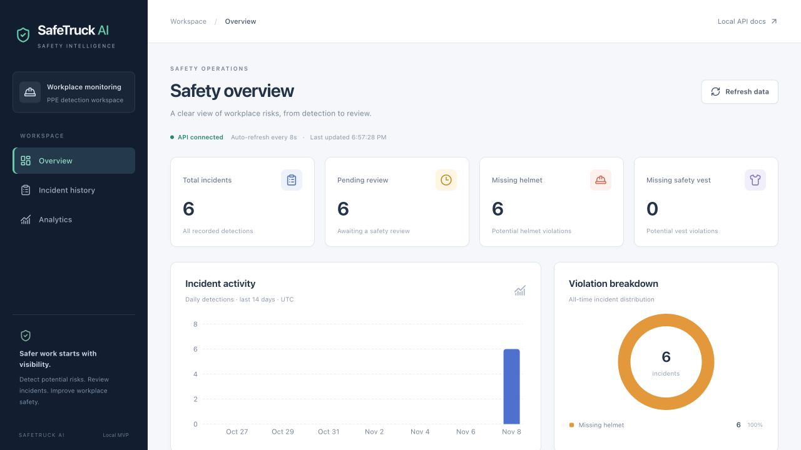
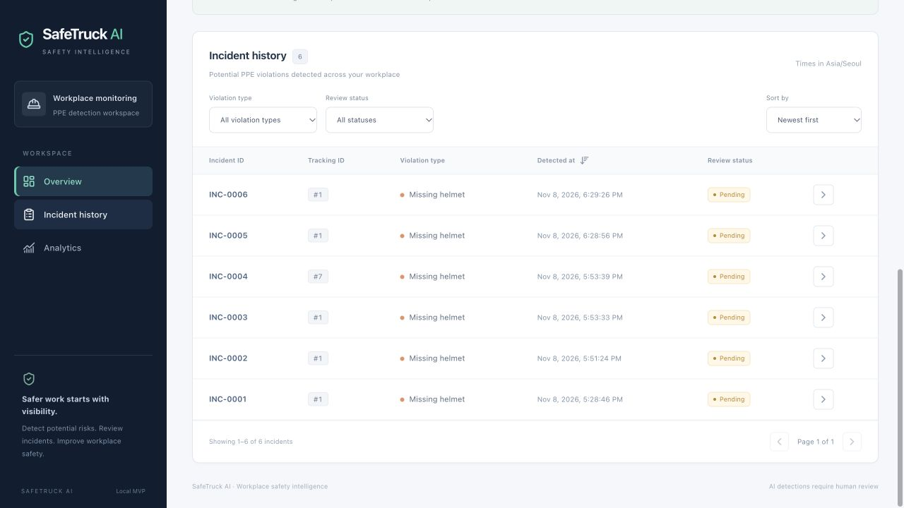
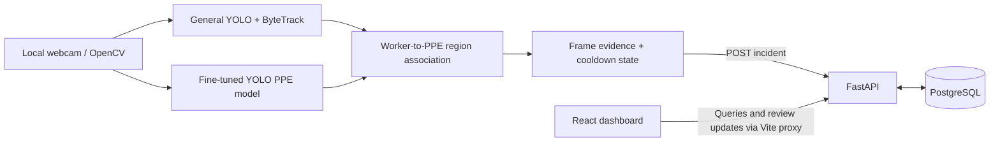

# SafeTruck AI

**A computer vision and full-stack portfolio project for reviewing potential workplace PPE violations.**

Construction and industrial safety teams need a practical way to notice missing protective equipment and review detections over time. SafeTruck AI combines local webcam inference, temporary worker tracking, persistent incident records, and a monitoring dashboard. It flags potential missing helmets and safety vests for human review; it does not identify workers or establish that a safety violation occurred.



*Actual application screenshot. The displayed records predate Phase 6 verification; no synthetic records were added to the configured incident database.*

[Demo guide](docs/demo-guide.md) · [Model evaluation](docs/model-evaluation.md) · [Final validation report](docs/final-validation.md) · [Portfolio description](docs/portfolio.md)

## What it does

- Tracks people with a general YOLO model and ByteTrack while running a separate fine-tuned PPE model.
- Associates helmet/vest evidence with a tracked worker's head and torso regions.
- Confirms missing-PPE evidence over multiple frames, suppresses duplicate alerts, and submits incidents to FastAPI.
- Stores incident type, temporary tracking ID, UTC timestamp, and review status in PostgreSQL.
- Displays all-time statistics, a 14-day UTC trend, violation distribution, and paginated incident history.
- Supports type/status filters, timestamp sorting, incident details, and pending/reviewed/dismissed review updates.
- Refreshes dashboard data automatically, with manual refresh and explicit loading, empty, timeout, and failure states.



## Stack

| Layer | Technologies |
| --- | --- |
| Vision | Python, Ultralytics YOLO26n, PyTorch, OpenCV, ByteTrack |
| API and persistence | FastAPI, Pydantic, SQLModel/SQLAlchemy, PostgreSQL 17 |
| Dashboard | React 19, TypeScript, Vite 6, Tailwind CSS 4, Lucide, Recharts |
| Local development | Docker Compose, pytest, npm lockfile |

The existing ML environment uses Python 3.11.18, Ultralytics 8.4.204, PyTorch 2.15.0, and OpenCV 4.14.0.94. Phase 6 also verified backend tests with Python 3.13 and the frontend with Node 22.23.1. Apple Silicon uses MPS when available; CPU is the fallback.

## Architecture



The dashboard receives incident records through HTTP, not camera frames. Database credentials remain in the backend environment. No video recording, streaming, evidence capture, or permanent worker identification is implemented.

### Inference and incident flow

1. OpenCV reads webcam 0 at a requested 640 × 480 resolution and flips each frame horizontally.
2. `yolo26n.pt` tracks only the person class at `imgsz=320`, `conf=0.25`, using `custom_tracker.yaml` and persistent ByteTrack state.
3. `models/best.pt` performs PPE inference at `imgsz=320`, `conf=0.20`. The checkpoint contains 12 classes; this application uses `helmet`, `vest`, `no_helmet`, and `no_vest`.
4. Equipment box centers are associated with the upper 35% of a person box for helmet evidence, or 25–80% for vest evidence.
5. Eight missing-PPE observations confirm an alert. They need not be strictly consecutive: up to nine unknown observations are tolerated, and ten reset the evidence. Detected compliant PPE resets the counter and takes priority over a simultaneous missing-PPE label.
6. A successful API submission latches the alert until evidence resets. A separate 30-second cooldown is keyed by tracking ID and violation type. Failed submissions do not consume the cooldown; there is no durable offline queue.
7. Worker state expires after ten seconds without seeing that tracking ID. The API assigns the persisted UTC timestamp and returns the stored record.

This architecture keeps general person tracking separate from the custom detector's PPE labels. All temporal state is process-local; restarting the detector resets it.

## Run locally

### Prerequisites and environment

Use Python 3.11 or 3.12 for a fresh ML environment, Node.js 20.19+ or 22.12+, npm, and Docker Desktop. An existing working ML environment can be reused—for example, `conda activate safeTruckAi` on the development machine. Do not replace a working environment or existing `.env` unnecessarily.

For a fresh checkout:

```bash
cd /path/to/safeTruckAi
python3.11 -m venv .venv
source .venv/bin/activate
python -m pip install -r requirements.txt -r requirements-backend.txt
cp .env.example .env  # New installation only; keep an existing .env
```

Set local PostgreSQL credentials in `.env`, keeping `POSTGRES_USER`, `POSTGRES_PASSWORD`, `POSTGRES_DB`, and `DATABASE_URL` consistent. URL-encode special characters in connection credentials. The supplied database driver is `postgresql+psycopg`. Changing environment values does not change a role/password in an already initialized Docker volume.

Place your existing `models/best.pt` and `yolo26n.pt` in their current locations. Weights and datasets are intentionally not committed. A fresh clone therefore needs the trained checkpoint separately; the backend and dashboard can run without the ML weights. This repository does not automatically download or retrain the custom model.

### Start the database

```bash
docker compose up -d postgres
```

PostgreSQL is published on `127.0.0.1:5433` and uses a named volume. Do not remove the volume when retaining incident history. Tables are created if absent; no Phase 6 database migration is required.

### Start FastAPI

From the repository root, in the selected Python environment:

```bash
uvicorn backend.main:app --host 127.0.0.1 --port 8000 --reload
```

[API documentation](http://127.0.0.1:8000/docs) · [Liveness](http://127.0.0.1:8000/health)

### Start the dashboard

In another terminal:

```bash
cd /path/to/safeTruckAi/frontend
npm ci
npm run dev
```

Open [localhost:5173](http://127.0.0.1:5173). The Vite proxy sends `/api` requests to port 8000. To change the proxy target, set `API_PROXY_TARGET` in `frontend/.env.local`. Optional `VITE_API_BASE_URL` sets a public browser API base; leave it blank for the same-origin proxy. Never put secrets in a `VITE_` variable; these values are included in browser code.

### Start webcam detection

In the ML environment, from the repository root:

```bash
python main.py
```

Grant camera access to the application hosting Python when macOS requests it. Press `q` in the OpenCV window to stop. `SAFETRUCK_API_URL` can override the incident destination for an isolated demo; its default is `http://127.0.0.1:8000/api/incidents`.

The Phase 6 execution host could not obtain camera authorization. Real model inference and tracking were verified on local dataset images, and the submission-to-dashboard path was verified separately. A physical webcam-to-incident run remains a manual acceptance step; see the [demo guide](docs/demo-guide.md).

## Model results

The checkpoint was trained for ten epochs at 416 pixels, batch 2, using MPS. Fresh CPU validation used the existing Construction-PPE validation split: **200 images, 2,961 objects, 12 classes**. No retraining was performed.

| Evaluation | Precision | Recall | mAP50 | mAP50–95 |
| --- | ---: | ---: | ---: | ---: |
| Saved checkpoint metrics | 0.7835 | 0.5151 | 0.5692 | 0.3697 |
| Fresh validation, 416 pixels | 0.7846 | 0.5151 | 0.5689 | 0.3700 |
| Fresh validation, runtime 320 pixels | 0.7448 | 0.4478 | 0.4929 | 0.3051 |

These aggregates cover all 12 classes. At 320 pixels, `no_helmet` recall is **0.3509** and `no_vest` recall is **0.4692**. Missing-PPE detection is a significant limitation. These are object-detection validation metrics, not end-to-end incident accuracy, tracking quality, or field safety certification. Per-class results, provenance, and reproducible commands are in [model evaluation](docs/model-evaluation.md).

## API

| Method | Endpoint | Purpose |
| --- | --- | --- |
| GET | `/health` | Process liveness; not camera/database health |
| POST | `/api/incidents` | Create `{ "worker_id": 8, "violation": "no_helmet" }`; 201 response |
| GET | `/api/incidents?limit=50` | Preserved legacy incident array; limit 1–100, newest ID first |
| GET | `/api/incidents/{id}` | Stored details; 404 if absent |
| PATCH | `/api/incidents/{id}` | Set `status` to `pending`, `reviewed`, or `dismissed` |
| GET | `/api/dashboard/incidents` | Paginated items/total/offset/limit; type/status filters and newest/oldest timestamp order |
| GET | `/api/dashboard/statistics` | All-time total, pending, missing-helmet, and missing-vest counts |
| GET | `/api/dashboard/analytics?days=14` | UTC daily buckets for 1–90 days and all-time violation distribution |

Invalid inputs return 422; missing records return 404; request-time database failures return a generic 503 without exposing SQL or connection credentials. The [OpenAPI contract](docs/openapi.json) describes the schemas.

All-time statistics and distribution include dismissed records and do not follow table filters. Daily charts use UTC; incident timestamps display in the browser's labeled local timezone. Each widget is a separate query snapshot, so new writes may briefly cause differences between widgets. Reviews use last-write-wins updates with no attribution or audit history.

## Tests and reproducibility

```bash
python -m pip install -r requirements-dev.txt
python -m pytest -q
python scripts/verify_postgres.py
cd frontend
npm run typecheck
npm run build
```

Default tests use in-memory SQLite and controlled detector inputs. They do not open a camera or load ML models. The PostgreSQL helper creates a disposable database, runs the same suite, reads the configured database, verifies its rows are unchanged, and removes only the temporary database. It requires a local role with `CREATEDB`; stop other writers during this preservation check. The temporary name retains the `_phase5_test_` safety guard expected by the existing fixture. Never point a destructive test fixture at your incident database.

Phase 6: **20 tests passed on SQLite and 20 on PostgreSQL**, TypeScript and production build passed, and browser review/filter/pagination checks passed using isolated synthetic records. The physical webcam check was blocked by host permissions. A later local `.env` edit caused an authentication failure, recorded separately from the passing tests. Full evidence and limits are in [final validation](docs/final-validation.md).

## Project layout

```text
main.py                       Webcam pipeline, frame evidence, HTTP incident submission
train.py                      Existing ten-epoch training entry point
custom_tracker.yaml           ByteTrack configuration
backend/                      FastAPI routes, validated schemas, SQLModel persistence
frontend/src/                 React components, typed API client, polling hook, dashboard
scripts/evaluate_model.py     Local validation with no retraining or downloads
scripts/verify_postgres.py    Disposable PostgreSQL regression/demo session
tests/                        Backend contract and controlled detector regression tests
docs/                         Evaluation, validation, demo, portfolio text, UI screenshots
```

`events.csv` is a legacy local artifact, not the current incident source. It is preserved on disk and excluded from Git tracking. PostgreSQL is the source of dashboard records.

## Limitations and deployment boundary

- Tracking IDs are temporary; occlusion or re-entry may produce a new ID. No identity recognition is implemented.
- Lighting, small objects, occlusion, camera position, and ambiguous PPE can cause false positives or missed detections. Region-based association can assign one item to overlapping workers.
- Ten training epochs and one validation split do not establish generalization to a new workplace. No independent field benchmark or end-to-end incident precision/recall was measured.
- The detector makes synchronous HTTP calls with a three-second timeout. Outages can delay inference, and there is no persistent retry queue. Process-local cooldowns do not deduplicate across restarts or multiple detector processes.
- There is no video streaming, recording, automatic evidence screenshot storage, camera-health telemetry, or permanent worker identity.
- Offset pagination can shift as records arrive; larger datasets may need indexing, retention, and cursor pagination.
- This is a **local portfolio MVP**, not a publicly deployed safety service. Authentication, authorization, TLS, controlled origins, request limits, backups, and operational monitoring are required before exposing incident data publicly. No deployment or complex authentication was added in Phase 6.

Secrets, local databases, datasets, recordings, generated builds, dependencies, and model weights are ignored. Earlier Git history was not rewritten; excluding a file now does not remove earlier copies. No commits or pushes were made during Phase 6.
