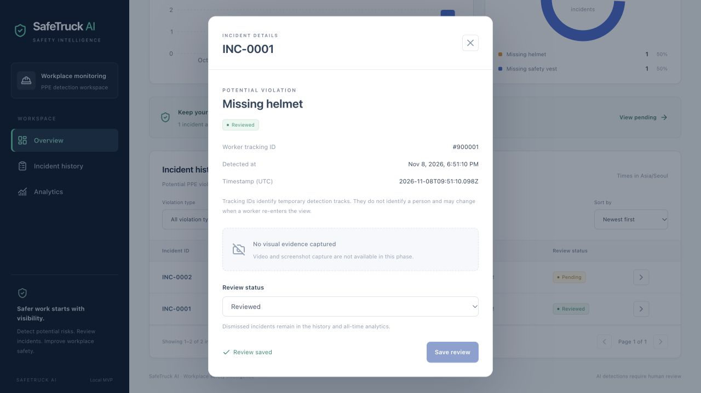

# SafeTruck AI: a short portfolio demo

Allow about three minutes after dependencies and services are running. Use the commands in the root README for the normal application. This guide keeps synthetic demonstrations separate from existing incident records.

## 1. Explain the system (20 seconds)

“SafeTruck AI detects potential missing helmets and safety vests, associates PPE evidence with temporary worker tracks, and stores confirmed alerts for human review. A React dashboard queries PostgreSQL through FastAPI. It does not identify workers or stream camera footage.”

Show the overview, incident history, UTC chart labels, and the explicit absence of captured evidence. Do not describe model detections as verified violations.

## 2. Run an isolated demo API

In a backend/test environment with `requirements-dev.txt` installed, from the repository root:

```bash
python scripts/verify_postgres.py --serve --port 8002
```

This creates a new, empty temporary PostgreSQL database using the configured local server. It requires the local database role's `CREATEDB` permission. It prints the temporary database name, serves only on loopback, and on Ctrl+C removes that temporary database and verifies the original incident rows remain unchanged. Stop other writers during this preservation check. Keep this terminal open for the demo.

In a second terminal:

```bash
cd frontend
API_PROXY_TARGET=http://127.0.0.1:8002 npm run dev -- --port 5174 --strictPort
```

Open <http://127.0.0.1:5174>. Confirm zero statistics and an empty history. Ports 8000/5173 and the existing database remain available independently.

## 3. Generate explicitly synthetic test incidents (30 seconds)

In another terminal, from the repository root:

```bash
SAFETRUCK_API_URL=http://127.0.0.1:8002/api/incidents python -c 'from main import save_event; assert save_event(900001, "no_helmet"); assert not save_event(900001, "no_helmet"); assert save_event(900002, "no_vest")'
```

Say explicitly: **“These are synthetic API test records in a disposable database, not webcam detections.”** The actual detector submission helper is used; the immediate duplicate is suppressed by its per-track/per-type cooldown. Importing `main` does not open the camera or load model weights.

Wait for polling, or select **Refresh data**. Expect two incidents, two pending reviews, one helmet incident, and one vest incident. Chart distribution should be 50/50, with two detections in today's UTC bucket.

## 4. Demonstrate review and filtering (45 seconds)

1. Open `INC-0001`, show its temporary tracking ID and timestamps.
2. Note that screenshots and video evidence are unavailable.
3. Set status to **Reviewed**, save, and show the success message.
4. Close details and filter by Reviewed: only the helmet test incident remains.
5. Add the Missing safety vest filter: the table should show no matching incidents.
6. Clear filters. The all-time total remains two while pending decreases to one.



*Phase 6 screenshot from the disposable database; tracking ID 900001 is synthetic.*

For pagination QA, add more than ten distinct synthetic tracking IDs only to this disposable API and verify both pages. Do not use the real incident database for this exercise.

## 5. Demonstrate the webcam detector when authorized (45 seconds)

In the working ML environment, from the repository root:

```bash
SAFETRUCK_API_URL=http://127.0.0.1:8002/api/incidents python main.py
```

Use a controlled desktop setting. Grant camera access to the host application if macOS requests it. Show the local OpenCV window and temporary track labels. When the model emits missing-PPE evidence across the confirmation threshold, the helper should save a potential incident and the isolated dashboard should display it. A sustained alert is latched; it does not create a new record every 30 seconds unless the evidence resets. Press `q` to stop.

A detection is not guaranteed. Do not pretend the synthetic API test proves webcam detection accuracy. During Phase 6, this execution host could not open the camera after OpenCV reported missing camera authorization and failed initialization. The live physical-camera sequence above remains an operator acceptance step; real MPS tracking/PPE inference was tested separately on local validation images.

If camera access fails, stop the attempt, grant permission in macOS Privacy & Security → Camera to the application launching Python, restart that application if needed, and rerun from a camera-authorized terminal. Camera permission availability depends on the host application; do not claim it is fixed until a frame is read.

## 6. Close with the evaluation (20 seconds)

“At the runtime resolution of 320 pixels, validation mAP50 is 0.4929 across 12 classes. Missing-helmet recall is 0.3509 and missing-vest recall is 0.4692. This is an engineering MVP with measured limitations and human review, not a validated safety enforcement product.”

Show `docs/model-evaluation.md` and `docs/final-validation.md`. Distinguish object detection, temporal alert logic, tracking, and backend correctness; they have different evidence.

## Cleanup

Stop the detector with `q`, the isolated frontend with Ctrl+C, then the demo API with Ctrl+C. The API helper removes only its newly created temporary database and prints the preservation check. Never use `docker compose down -v` to clean up this demo. The pre-existing incident database must remain intact.
